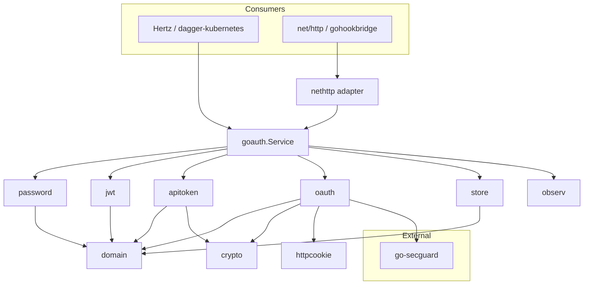

# go-auth

`github.com/disaster37/go-auth` is a production-grade, framework-agnostic
authentication and security-guardrail library for Go. It unifies the hardened
authentication subsystems of `dagger-kubernetes` (CloudWeGo Hertz) and
`gohookbridge` (`net/http` + `chi`) behind a small set of composable packages.

The core packages depend only on the Go standard library plus minimal
crypto/OIDC/JWT libraries. No HTTP framework is imported by the core; an
optional `nethttp` adapter provides `net/http` middleware and handlers, while
Hertz integrates in roughly twenty lines using the core, `httpcookie`, and
`github.com/disaster37/go-secguard` primitives.

## Features

- **Unified token model** — HS256 JWT access/refresh/OAuth-state pairs and
  compact HMAC-SHA256 session tokens, both with RFC 5869 HKDF-SHA256 key
  derivation and domain separation.
- **Dual revocation** — per-user `TokenVersion` and cluster-wide `AuthEpoch`.
- **Hardened OAuth2/OIDC** — PKCE `S256`, OIDC `nonce`, signed state bound to a
  constant-time cookie nonce, multi-audience `azp` verification,
  `email_verified` enforcement, userinfo claim merge, 1 MiB response cap,
  cross-origin redirect refusal, and `allowed_endpoints` validation.
- **Single-flight revalidation** — `oauth.Revalidator` caches IdP membership
  checks with crypto-seeded jitter, an offline grace window, fail-open/fail-closed
  policy, `SessionMaxAge`, and leader-only refresh.
- **Configurable API tokens** — `dct_`/`ghb_`-style prefixes, 32-byte CSPRNG
  generation, SHA-256 hashing, constant-time comparison, and at-rest encryption.
- **Defense in depth** — exponential `lockout.Limiter`, credential-stuffing
  `bantracker.BanTracker`, sliding-window `ratelimit.RateLimiter`/`LoginThrottle`,
  trusted-proxy `realip.ExtractRealIP`, `SafeRedirectPath`, browser security
  headers, and CSRF `headers.CheckMutationOrigin`.
- **Turnkey facade** — root `goauth.Service` resolves bearer/cookie credentials,
  logs users in, rotates refresh tokens, and revokes sessions.

## Architecture



## Package map

| Package | Purpose |
|---|---|
| `domain` | Pure entities, value types, and sentinel errors (stdlib only). |
| `crypto` | HKDF-SHA256 key derivation and AES-256-GCM at-rest sealing. |
| `store` | Persistence interfaces and thread-safe in-memory implementations. |
| `password` | bcrypt hashing, timing-equalized authentication, password changes. |
| `jwt` | HS256 JWT pairs, OAuth state, and compact session tokens. |
| `apitoken` | Configurable-prefix API token lifecycle. |
| `oauth` | OIDC/GitHub providers, PKCE, group mapping, credential sealing, revalidation. |
| `httpcookie` | Framework-agnostic cookie specs and open-redirect defense. |
| `observ` | Structured logger interface and adapters. |
| `config` | Configuration structs, defaults, and strict validation. |
| `nethttp` | Optional `net/http` middleware and handlers. |
| `testutil` | Fake clock and in-process mock OIDC server. |
| `goauth` (root) | Turnkey `Service` facade and re-exported domain types. |

External dependencies: `github.com/disaster37/go-secguard` provides lockout,
rate limiting, ban tracking, real IP resolution, security headers, and CSRF
origin validation.

## Quickstart — `net/http`

```go
package main

import (
    "net/http"

    goauth "github.com/disaster37/go-auth"
    "github.com/disaster37/go-auth/httpcookie"
    "github.com/disaster37/go-auth/nethttp"
)

func main() {
    svc := goauth.NewService(goauth.ServiceConfig{
        // Users, UserStore, Groups, Epochs, Tokens, JWT, Logger...
    })
    cfg := httpcookie.DefaultConfig()

    mux := http.NewServeMux()
    mux.Handle("POST /login", nethttp.LoginHandler(svc, jwtSvc, cfg, false))
    mux.Handle("POST /refresh", nethttp.RefreshHandler(svc, jwtSvc, cfg, false))
    mux.Handle("POST /logout", nethttp.LogoutHandler(svc, cfg, false))
    mux.Handle("GET /me", nethttp.RequireAuth(svc, cfg)(http.HandlerFunc(me)))

    handler := nethttp.SecurityHeadersMiddleware(
        nethttp.MutationOriginMiddleware([]string{"https://app.example.com"})(mux),
    )
    _ = http.ListenAndServe(":8080", handler)
}
```

## Quickstart — CloudWeGo Hertz

See [`docs/hertz-integration.md`](docs/hertz-integration.md) for a copy-pasteable
adapter that sets cookies, extracts bearers, resolves the real client IP, and
maps errors to HTTP status codes.

## Security highlights

- Constant-time comparisons for passwords, token hashes, OAuth state, and nonces.
- Bounded maps and network reads (1 MiB provider responses, 64 KiB login bodies).
- Secrets never logged; sensitive struct fields carry `json:"-"`.
- Open-redirect and CSRF defenses built in.
- Short-lived access tokens, rotatable refresh tokens, and two independent
  revocation counters.

See [`SECURITY.md`](SECURITY.md) for the full threat model and reporting policy.

## Documentation

- [`docs/api.md`](docs/api.md) — generated package reference.
- [`docs/configuration.md`](docs/configuration.md) — every configuration key.
- [`docs/hertz-integration.md`](docs/hertz-integration.md) — Hertz adapter.
- [`docs/design/`](docs/design/) — architecture decision records.

## License

MIT. See [`LICENSE`](LICENSE).
